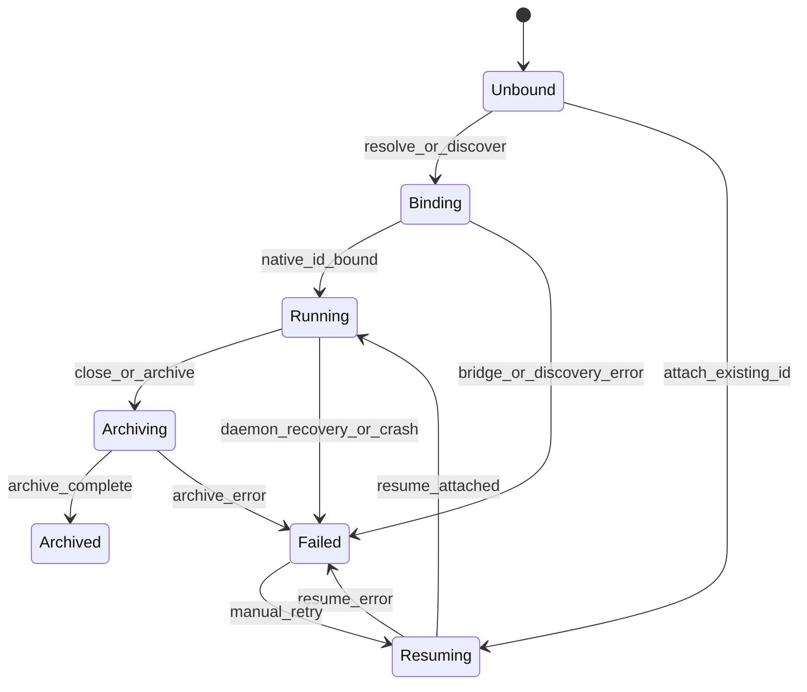
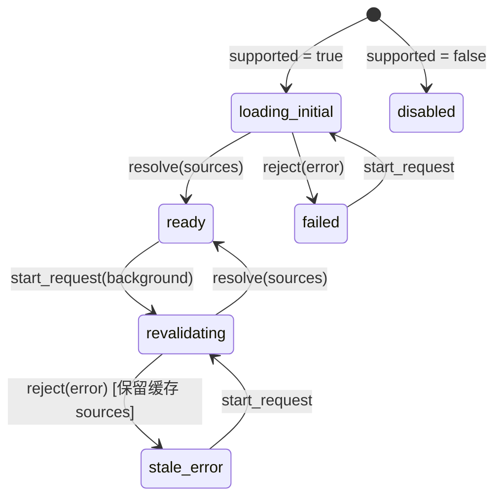
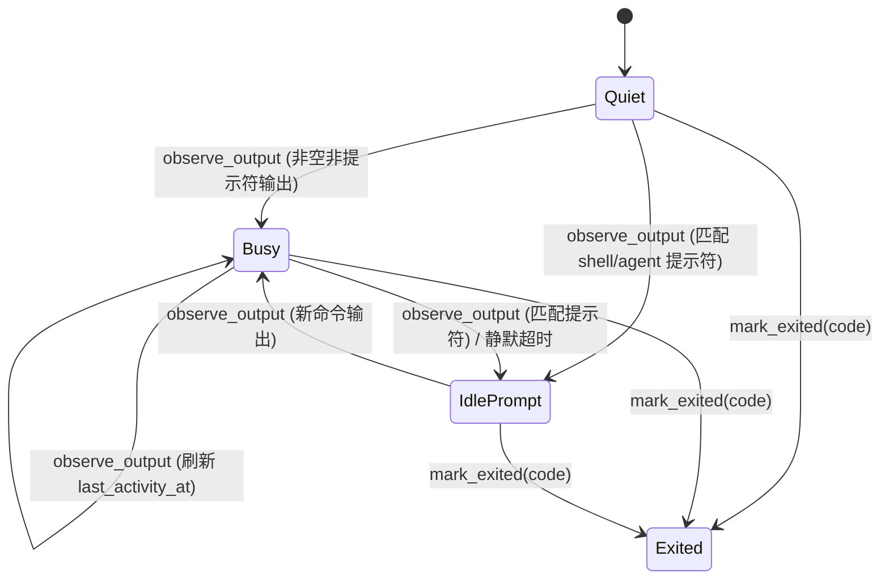

# Prospero 显式状态机架构与 TUI 终端配色规范

> 本文记录 Prospero 在 Rust 守护进程（`crates/prospero-protocol`、`apps/daemon-rs`）与桌面端（`apps/desktop`）中对**隐式状态机（Implicit State Machines）**的系统性收敛，以及针对 Coding Agent TUI（Codex、Claude Code、Antigravity `agy`、Pi 等）的统一深色碳素调色板规范。
>
> 核心设计目标：以**代数数据类型（Rust `enum` / TypeScript Discriminated Union）**和**纯状态转移函数（Reducers）**消除散落的布尔标志位与硬编码字符串集合，同时提升 **用户体验（UX）**、**开发者体验（DX）** 和 **代理体验（AX）**。

---

## 1. 为什么要消灭隐式状态机

在重构前，项目中存在若干由多个布尔变量、`Option` 时间戳或散落的字符串集合拼接而成的「隐式状态机」：

1. **状态集合漂移（DX / UX 问题）**：不同模块各自维护一份 `ENDED_SESSION_STATUSES` 或 `READ_ONLY_TERMINAL_STATUSES`，一旦新增或遗漏某个状态值（如 `stopped`、`cancelled`），就会出现侧边栏显示已结束但终端仍尝试重连、或注意力提醒（Attention Badge）无法消除的矛盾。
2. **后台刷新抹除缓存（UX 问题）**：模型源（Model Sources）原本仅用 `{ sources, loading, error }` 三个状态变量；窗口重新获得焦点触发后台刷新时，`loading` 置为 `true` 锁死下拉框，且一旦后台请求因瞬时错误或新账号类型（如 `native-agy`）校验失败，就会弹出「模型源请求失败，请刷新确认后重试」阻塞创建会话。
3. **非法组合态（AX / DX 问题）**：PTY 输出活跃度原本用 5 个独立字段（`exited`、`exit_code`、`busy_since`、`last_activity_at`、`idle_prompt_since`）表示，理论上存在 `2^5` 种组合；Agent 事件流翻译器若在子进程异常退出时未结算运行中的工具调用，会导致前端工具卡片永远处于 `Running` 旋转态。

---

## 2. P0：协议与会话核心状态机

### 2.1 协议层会话与原生绑定状态机（`crates/prospero-protocol`）

**源码位置**：[`crates/prospero-protocol/src/lib.rs`](../crates/prospero-protocol/src/lib.rs)

#### `SessionStatus` 生命周期谓词
在协议层 `SessionStatus` 上提供统一的生命周期判定方法，作为全栈语义基准：
- `is_active_turn()`：`Starting | Running`
- `is_waiting_user()`：`WaitingApproval | WaitingInput`
- `is_terminal()`：`Completed | Done | Died`
- `is_read_only_pty()`：`Idle` 或 `is_terminal()`

#### `NativeSessionState` 显式状态机
原生 CLI 会话（Claude Code / Codex / Antigravity）与 Prospero 会话的绑定生命周期由 `NativeSessionState` 枚举建模：

- **合法状态**：`Unbound | Binding | Resuming | Running | Archiving | Archived | Failed`
- **不变量**：
  - `NativeSession::transition(&mut self, next: NativeSessionState, error: Option<String>)` 保证进入非 `Failed` 状态时自动清除残留的 `error` 字段。
  - `SessionHead::is_login_session()` 显式排除 `· 登录` 临时认证终端，避免误弹「关联原厂会话」对话框。

---

### 2.2 桌面端单一会话状态机真源（`apps/desktop/src/shared/session-state.ts`）

**源码位置**：[`apps/desktop/src/shared/session-state.ts`](../apps/desktop/src/shared/session-state.ts)

桌面端所有组件与状态模块统一从 `session-state.ts` 导入状态机派生函数，彻底移除各组件私有的状态字符串集合：

| 函数 / 类型 | 职责 | 接入模块 |
|---|---|---|
| `deriveSessionLifecyclePhase(session)` | 将会话状态映射为 `starting \| running \| waiting_user \| idle \| ended` 可辨识联合类型 | `App.tsx`、`attention-state.ts` |
| `isSessionEndedStatus(status)` | 判定会话是否处于终态（`completed / done / died / failed / error / cancelled / exited / killed / stopped`） | `App.tsx`、`shell-session.ts`、`remote-workspace-state.ts` |
| `isReadOnlyTerminalStatus(status)` | 判定终端是否只读（`idle` + 所有终态） | `NativeTerminalPane.tsx`、`TerminalPane.tsx` |
| `deriveNativeBindingPhase(session)` | 派生原生绑定相位：`not_applicable \| unbound \| transitioning \| bound \| failed` | `NativeSessionBindingDialog.tsx`、`App.tsx` |
| `needsNativeBinding(session)` | 判定关闭/归档前是否需要提示用户关联原生 CLI 会话 | `NativeSessionBindingDialog.tsx`、`App.tsx` |

---

### 2.3 模型源目录 Stale-While-Revalidate 状态机与前向兼容校验

**源码位置**：
- [`apps/desktop/src/renderer/src/model-sources/use-model-sources.ts`](../apps/desktop/src/renderer/src/model-sources/use-model-sources.ts)
- [`apps/desktop/src/shared/model-sources.ts`](../apps/desktop/src/shared/model-sources.ts)

- **UX / DX 提升**：
  1. **Stale-While-Revalidate**：当 `current.sources.length > 0` 时，窗口焦点触发的后台刷新进入 `revalidating` 而非 `loading_initial`，UI 不会闪烁或禁用选择器；若后台刷新失败，进入 `stale_error` 并保留上次成功的 `sources` 与最新 `revision`。
  2. **Envelope 前向兼容**：[`modelSourceResult`](../apps/desktop/src/shared/model-sources.ts#L9-L28) 在校验 `S2CModelSourceResultSchema` 前，使用 `AgentAccountSchema.safeParse` 过滤 `accounts` 列表中的未知账号项，确保守护进程新增 Agent 类型（如 `agy`）时不会破坏模型源列表与绑定响应。

---

## 3. P1：跨模型编排、PTY 活跃度与 Agent 事件流状态机

### 3.1 跨模型子代理投递状态机（`CrossModelChildStatus` & `CrossModelDeliveryPhase`）

**源码位置**：
- [`apps/daemon-rs/src/agent.rs`](../apps/daemon-rs/src/agent.rs#L150-L240)
- [`apps/daemon-rs/src/agent/store.rs`](../apps/daemon-rs/src/agent/store.rs)

将跨模型子会话（`prospero child`）的执行态与父会话 Fan-in 投递态拆分为两个正交的显式状态机：

1. **`CrossModelChildStatus`**：`Starting | Running | Completed | Failed | Stopped`（`is_terminal()` 为后三者）。
2. **`CrossModelDeliveryPhase`**：
   - `InFlight`：子代理仍在运行，尚未产出终态结果。
   - `ReadyToDeliver`：子代理已进入终态，等待向父会话注入增量或最终汇报。
   - `DeliveredPendingAck { delivered_at }`：结果已投递至父会话，等待父代理调用 `prospero child ack`。
   - `Acknowledged { delivered_at, acknowledged_at }`：父代理已确认消费该结果。

---

### 3.2 PTY 输出活跃度状态机（`PtyActivityPhase`）

**源码位置**：[`apps/daemon-rs/src/terminal.rs`](../apps/daemon-rs/src/terminal.rs#L40-L81)

- **不变量**：
  - `Busy { busy_since, last_activity_at }`、`IdlePrompt { since, last_activity_at }`、`Exited { exit_code }` 互斥。
  - 一旦进入 `Exited`，`busy_since()` 与 `idle_prompt_since()` 必定返回 `None`，从类型系统层面根除「进程已退出但会话仍显示繁忙」的幽灵状态。

---

### 3.3 Agent Turn 事件流状态机（`TurnStreamStateMachine`）

**源码位置**：
- [`apps/daemon-rs/src/agent/turn_stream.rs`](../apps/daemon-rs/src/agent/turn_stream.rs)
- [`apps/daemon-rs/src/agent/agy.rs`](../apps/daemon-rs/src/agent/agy.rs)

管理单轮 CLI / JSON-RPC 事件流向归一化 `AdapterEvent` 的转换：

- **`TurnPhase`**：`Bootstrapping -> Streaming -> Finished`
- **`ToolCallPhase`**：`Running { subagent, name, summary } -> Finished`
- **核心保障（AX & UX）**：
  1. `observe_native_id` 保证每轮最多发送一次 `AdapterEvent::NativeId`。
  2. 按 `step_index` 聚合 `thinking` 与 `text` 增量/快照，仅在合并文本实际变化时发射事件。
  3. 每个 `call_id` 严格遵循 `Absent -> Running -> Finished`；若收到 `ToolResult` 时未曾收到 `ToolCall`，自动补发 `ToolCall`。
  4. `finalize(interrupted, fallback_error, diffs)` 在进程结束或异常中断时，**自动遍历并结算所有仍处于 `Running` 的工具调用**（发射 `AdapterEvent::ToolResult`），最后幂等发射唯一一次 `AdapterEvent::Finish`。

---

## 4. P2：桌面端终端视图与工作区分屏状态机

### 4.1 终端视图相位状态机（`TerminalViewPhase`）

**源码位置**：
- [`apps/desktop/src/renderer/src/terminal-view-state.ts`](../apps/desktop/src/renderer/src/terminal-view-state.ts)
- [`apps/desktop/src/renderer/src/NativeTerminalPane.tsx`](../apps/desktop/src/renderer/src/NativeTerminalPane.tsx)
- [`apps/desktop/src/renderer/src/TerminalPane.tsx`](../apps/desktop/src/renderer/src/TerminalPane.tsx)

将原生 Ghostty 视图与内置 xterm.js 视图的连接、控制权（Lease Controller）、只读观察与断连状态收敛为 7 个互斥相位：

- `probing`：正在探测本机 Ghostty 可用性
- `fallback`：回退至内置 xterm.js 渲染器
- `connecting`：正在建立终端流同步
- `observing`：已连接但处于只读观察模式（未持有控制权租约）
- `controlling`：已连接且持有写控制权（唯一允许键盘输入与图片粘贴的相位）
- `disconnected`：终端流连接已断开（当无活跃 surface 时展示重连/切换内置视图横幅）
- `exited`：会话已结束，只读展示历史画面

---

### 4.2 工作区分屏布局状态机（`WorkspaceSplitLayoutState`）

**源码位置**：
- [`apps/desktop/src/renderer/src/workspace/pane-layout-state.ts`](../apps/desktop/src/renderer/src/workspace/pane-layout-state.ts)
- [`apps/desktop/src/renderer/src/workspace/WorkspacePane.tsx`](../apps/desktop/src/renderer/src/workspace/WorkspacePane.tsx)

通过纯 Reducer [`reduceSplitLayout`](../apps/desktop/src/renderer/src/workspace/pane-layout-state.ts#L64-L137) 统一维护 `{ activeId, splitId, focusedId, ratio, stacked }`：

- **主副屏自动互换不变量**：当用户在标签栏点击已处于副屏（`splitId`）的会话使其成为 `activeId` 时，`sync_active` 动作原子性地将原 `activeId` 移入 `splitId`，保证 `splitId !== activeId` 恒成立，无需额外的 `useRef` 与二次 `useEffect` 修补。
- **焦点收敛不变量**：`reconcile_visible` 确保 `focusedId` 始终落在当前可见的主屏或副屏会话上。
- **比例钳制**：`clampSplitRatio` 将分屏比例严格限制在 `[25, 75]` 区间内。

---

## 5. TUI 终端配色规范（Ghostty & xterm.js 统一调色板）

**源码位置**：
- [`apps/desktop/src/shared/terminal-typography.ts`](../apps/desktop/src/shared/terminal-typography.ts#L19-L45)（`PROSPERO_TERMINAL_THEME`）
- [`apps/desktop/native/ghostty/config`](../apps/desktop/native/ghostty/config)
- [`apps/desktop/src/renderer/src/TerminalPane.tsx`](../apps/desktop/src/renderer/src/TerminalPane.tsx#L447-L462)
- [`apps/desktop/src/renderer/src/remote-workspaces/RemoteTerminal.tsx`](../apps/desktop/src/renderer/src/remote-workspaces/RemoteTerminal.tsx#L55)
- [`apps/daemon-rs/src/terminal/runtime.rs`](../apps/daemon-rs/src/terminal/runtime.rs#L959)

### 5.1 为什么此前 TUI 配色显得古怪
1. **Ghostty 缺少 16 色调色板定义**：`native/ghostty/config` 原本仅设置了 `background` 和 `foreground`，未配置 `palette = 0..15`，导致 Ghostty 回退到默认 VGA 16 色。Codex / Claude Code / Pi 等现代 TUI 大量使用 **ANSI 8 (`brightBlack`)** 绘制圆角边框（`╭─╮`）、次要提示（`+ 795 lines (⌃t to expand)`）、树状连接符（`└`）和字符画阴影（`⣀⣤⣤⣤⣀⣀`），并使用 **ANSI 0 (`black`)** 作为输入框或状态胶囊底色。
2. **xterm.js 强制对比度拉伸失真**：`TerminalPane.tsx` 与 `RemoteTerminal.tsx` 原本开启了 `minimumContrastRatio: 4.5` 与 `drawBoldTextInBrightColors: true`，且 `brightBlack` 设为 `#4b4e58`（对比度仅 2.08:1）。xterm.js 会强制改变所有低于 4.5 对比度的前景色（包括 24-bit RGB 渐变字符画、暗色文本与 diff 行），导致色彩发灰、泛白失真。
3. **缺少 `COLORFGBG` 环境变量**：部分 TUI 框架（ratatui / lipgloss / termenv）在启动时通过 `COLORFGBG="15;0"` 立即判定深色终端背景；若未设置，可能回退到浅色或高反差配色。

### 5.2 统一深色碳素调色板（`PROSPERO_TERMINAL_THEME`）

| ANSI 索引 | 角色 | 色值 | 设计说明 |
|---|---|---|---|
| — | `background` | `#16171a` | 与桌面端 `--terminal-background` / `--surface-0` 完全一致 |
| — | `foreground` / `cursor` | `#e6e9f0` | 柔和冷白，长时间阅读不刺眼 |
| — | `selectionBackground` | `#2b3b5c` | 高辨识度深蓝选区底色 |
| `0` | `black` | `#20232b` | 略高于背景 `#16171a`，使 TUI 输入框与状态栏胶囊层次清晰 |
| `8` | `brightBlack` | `#7d8597` | 在 `#16171a` 上提供 ~4.4:1 对比度，边框、树分支与次要文本清晰且不抢主文本视觉焦点 |
| `1` / `9` | `red` / `brightRed` | `#f06b74` / `#ff878f` | 错误提示与 diff 删除行 |
| `2` / `10` | `green` / `brightGreen` | `#62c897` / `#7ee0b0` | 成功状态与 diff 新增行 |
| `3` / `11` | `yellow` / `brightYellow` | `#e8b259` / `#f5c776` | 警告、审批提示与流式状态高亮 |
| `4` / `12` | `blue` / `brightBlue` | `#6ea4f8` / `#8cb8ff` | 链接、主色调与文件路径 |
| `5` / `13` | `magenta` / `brightMagenta` | `#b98ef5` / `#ceaaff` | 关键字、Review 标记与 Agent 徽章 |
| `6` / `14` | `cyan` / `brightCyan` | `#59c4dc` / `#7ad9ee` | 工具调用、命令参数与符号高亮 |
| `7` / `15` | `white` / `brightWhite` | `#c9d0de` / `#f2f5fa` | 次级亮白与强调标题 |

### 5.3 渲染器与环境变量一致性规则
- **Ghostty**：在 `apps/desktop/native/ghostty/config` 中完整声明 `palette = 0..15`、`cursor-color`、`selection-background` 与 `bold-is-bright = false`。
- **xterm.js**：在 `TerminalPane.tsx` 与 `RemoteTerminal.tsx` 中设置 `minimumContrastRatio: 1` 与 `drawBoldTextInBrightColors: false`，忠实还原 TUI 的 16 色与 24-bit TrueColor 输出。
- **Daemon PTY 环境**：在 `apps/daemon-rs/src/terminal/runtime.rs` 中注入 `COLORFGBG="15;0"`、`COLORTERM="truecolor"`、`CLICOLOR="1"`。

---

## 6. 回归测试覆盖

- **桌面端状态机与调色板单测**：[`apps/desktop/test/explicit-state-machines.test.ts`](../apps/desktop/test/explicit-state-machines.test.ts)
- **Rust 守护进程状态机单测**：
  - `apps/daemon-rs/src/agent/turn_stream.rs`（`emits_native_id_once_and_settles_open_tools_on_finalize`）
  - `apps/daemon-rs/src/agent/agy.rs`（`translates_stream_json_init_step_and_result`、`translates_tool_call_and_agent_response_steps`）
  - `apps/daemon-rs/src/terminal.rs`（`output_activity_clears_when_prompt_returns` 等）
