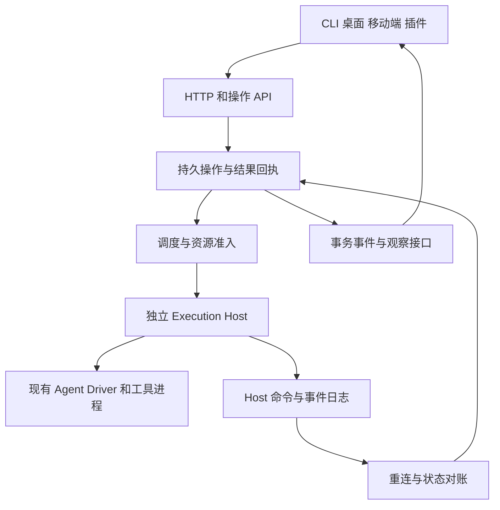

# Prospero 稳定运行完整改造规划

版本：1.0\
日期：2026-10-18，America/Los_Angeles\
状态：原始设计基线；当前实现及未完成项见[实施与验收记录](prospero-runtime-reliability-implementation.md)\
主仓基线：`b4e34246`，实施前必须重新核对 HEAD 与工作区\
任务下发入口：[Agent 工作包与下发说明](prospero-runtime-reliability-agent-tasks.md)

## 1 改造目标与范围

本次改造提高 Prospero 长时间、无人值守、多任务运行的稳定性。保留现有任务 DAG、显式交付、工作树管理、插件机制和业务判定，完善执行进程、操作账本、资源准入、结果交付和恢复之间的闭环。

完整交付的标准是：每个已接收操作都能查询，每次执行都有可验证的归属，每个未完成任务都处于可推进或有明确处理责任的等待状态；daemon 重启、调用超时和事件断线不会造成盲目重派、执行丢失、无限占位或错误完成。

### 1.1 包含的工作

- Rust daemon 的结构化 Agent 执行生命周期与独立执行宿主。
- 启动、停止、消息投递、结果提交的持久操作与回执。
- 执行身份、代次、事件恢复和状态一致性。
- 准入、资源释放、背压、错误分类和分层重试。
- CLI、HTTP、桌面、移动端和插件调用方的兼容与迁移。
- 存储迁移、发布包固定、备份恢复、故障注入、长跑和回退。
- 所有已支持执行后端遵守同一生命周期契约；后端能力差异必须显式声明。

### 1.2 不包含的工作

- 不开展面向特定 Harness 的专项改造，不选择或替换模型。
- 不修改调用方的业务阶段、验收标准、输入规则和证据门槛。
- 不重写桌面界面、终端渲染、远程网络或账号产品功能。
- 不把整个系统改造成多机分布式调度平台，不引入共享文件系统上的多写者 SQLite。
- 不自动重跑历史业务任务，不批量改写历史失败、证据或结论。

现有 [API 工作流执行改造方案](api-workflow-execution-plan.md) 属于插件业务层规划。本方案只提供稳定执行基础和必要的调用方兼容；两份方案不得各自新增相互竞争的物理资源账本。

## 2 现状依据与实施基线

以下结论基于本地主仓源码，不代表线上已经部署同一版本。实施的第一项任务是冻结仓库、构建产物、协议和部署基线。

| 已有能力或问题 | 依据 | 实施决定 |
| --- | --- | --- |
| DAG、显式交付、事务事件、活动 Dispatch 唯一约束已经存在 | `apps/daemon-rs/src/orchestration/schema.sql`、`store.rs` | 复用；不再构建平行 DAG 系统 |
| 持久启动队列、operation ID 去重、查询、取消排队和分维度准入已经存在 | `orchestration/start.rs`、`schema-v31.sql`、`server.rs` | 扩展成统一操作协议；保留原启动记录可读 |
| HTTP 支持 `Prefer: respond-async` 和 `/v1/workers/start-operations/{id}` | `server.rs` 的 `start_worker_route` | 调用方逐步迁移；服务端保留受限同步兼容 |
| 批量 task activity 与事件分页、订阅已经存在 | `orchestration/activity.rs`、`server.rs` | 扩展字段和消费契约，避免重新建设重复通道 |
| 数据库已有控制队列、后台队列、读取池、背压及健康指标 | `worker.rs`、`reader.rs`、`error.rs` | 保留公平性与有界队列，补进度和恢复保障 |
| Rust Agent shutdown 会结束驱动，recover 会归档旧活动会话 | `agent/runtime.rs` 的 `shutdown`、`recover` | 增加独立执行宿主，明确旧模式能力 |
| close 在 kill 后等待最多 3 秒，忽略等待结果并归还许可 | `agent/runtime.rs` 的 `finish_close` | 将退出确认、未知状态和容量释放做成闭环 |
| stop 先改变 task/dispatch，再关闭执行会话 | `orchestration/workers.rs` 的 `stop_worker` | 分离逻辑结算与物理停止，未知执行不能被视为已释放 |
| 部分失败事件只保留概括文本 | `agent/codex.rs` 的 `turn/completed`、`agent/claude.rs` 的事件类型 | 统一结构化失败，保留后端诊断引用 |
| TypeScript 版本已有独立 supervisor 和 Windows Session Host | `apps/daemon/src/structured-supervisor*`、`windows-structured-session-host.ts` | 复用已验证的设计和测试；不能把旧实现的保证算作 Rust 已实现 |
| 部分插件还采用同步启动和自行读取会话存储 | 外部调用方的控制适配层与资源统计模块 | 提供稳定 API，再迁移调用方，保留兼容期 |

本次前序检查实际运行的定向测试：启动队列相关 12/12 通过；后端事件映射定向测试 3/3 通过；`--test orchestration` 为 27 通过、7 失败。七处失败均停在数据库版本实际为 34、测试仍断言 33。需要更新过期断言并保留真正的表、索引、数据和迁移幂等校验，不能仅删除版本检查。

主仓存在用户正在进行的终端和桌面改动，以及未跟踪文档。各实施 Agent 必须使用独立工作区或明确的文件归属；不得覆盖、清理或重置这些改动。最终验收必须针对合并后的同一个提交，不能拼接不同工作区的通过结果。

## 3 必须保持的系统不变量

| 编号 | 不变量 |
| --- | --- |
| I01 | 同一 Task 在任意时刻最多存在一个允许执行的 attempt；启动未知、停止未知、宿主失联仍阻止冲突的新 attempt |
| I02 | 相同操作 ID 和相同请求指纹只代表同一操作；不同参数复用 ID 必须冲突 |
| I03 | 超时、断线、进程心跳丢失本身均不能证明外部操作没有发生 |
| I04 | 只有明确交付及绑定的验收契约满足后才能产生任务业务终态；对话结束、进程退出和连接关闭不等于成功 |
| I05 | 业务结果与执行进程状态分别存储；结果已验收不会掩盖仍在运行或尚未确认停止的进程 |
| I06 | 物理执行容量只能在退出确认或经验证的无进程启动失败后释放，不能按租约年龄盲清 |
| I07 | 旧执行代次的结果、事件和停止指令不能改变新 attempt；事件去重与能力校验均绑定完整身份 |
| I08 | 已完成业务结果保持单调；迟到事件可以补充审计，不可重新打开 Task |
| I09 | 操作记录及事件先可靠持久化，再对外确认；通知允许重复，权威状态变更必须幂等 |
| I10 | daemon 断开不会隐式停止受托管执行，也不会隐式批准等待中的交互 |
| I11 | 未知执行的隔离占用、待处理恢复和待发送回执都有持久责任记录与下一次处理条件 |
| I12 | 操作、调度、存储、事件缓冲、诊断和模型调用的重试均有边界，不得通过层层重试形成无上限放大 |
| I13 | 同一权威数据目录只有一个有效 daemon 写者；不同 daemon 共用宿主机预算时由独立且唯一的预算服务协调 |
| I14 | 系统故障和容量等待不改变插件业务结论，不消耗插件业务探索预算 |

本方案保证的是控制操作去重、执行归属和恢复决策可验证。外部 HTTP、云任务、模型工具及其他第三方副作用不具备通用 exactly-once 保证。执行者在外部调用后、落回执前崩溃时，必须记录未知结果并采用能力特定的查询或检查点恢复。

## 4 目标架构与权威数据



### 4.1 组件职责

| 组件 | 权威职责 | 不承担的职责 |
| --- | --- | --- |
| daemon | Task、Dispatch、attempt、操作状态、授权、调度、业务交付记录 | 不以连接是否存在推断进程结束 |
| Execution Host | 已托管进程、命令接收、工具子进程归属、事件日志、退出证明 | 不决定业务成功，不自行派发新 Task |
| Driver | 具体执行后端协议与错误映射、取消能力、原生会话标识 | 不直接释放 daemon 资源，不自行决定业务重试 |
| Admission | 配额认领、保留、释放和等待原因 | 不用长期会话数量代替真实执行压力 |
| Reconciler | 汇合操作记录、Host 证明、任务终态和事件，执行确定性状态迁移 | 不根据自然语言猜测业务结果 |
| 插件 | 业务计划、证据、业务验收和业务预算 | 不成为物理进程生命周期的第二权威 |
| 客户端 | 发起操作、查询回执、展示状态 | 不直接改数据库，不自行释放租约 |

### 4.2 数据归属

daemon SQLite 继续存储全局控制状态。Host 使用各自私有持久目录保存命令去重记录、事件和运行身份，避免 daemon 升级或写队列拥塞切断进程控制。两处存储分别拥有不同事实，使用确定 ID 和重复可安全消费的回执收敛，不实现跨进程分布式事务。

业务日志、证据文件和 UI 快照分别引用原始记录。UI 缓存不能作为恢复的权威依据。事件时间使用墙钟作审计，活动超时使用单调时钟；跨重启的调度时间保存绝对到期值并处理时钟跳变，不用未持久化的 monotonic 值跨进程比较。

## 5 执行身份和状态机

### 5.1 身份字段

| 字段 | 定义 |
| --- | --- |
| `task_id` | 既有业务任务 ID |
| `dispatch_id` | 既有派发记录 ID；同一 attempt 内固定 |
| `attempt_id` | 一次逻辑执行的 ID；首次重试前必须创建新 attempt |
| `execution_epoch` | Task 的执行代次，事务分配并递增；同一 attempt 重连不递增 |
| `host_id`、`host_epoch` | 受托管宿主身份和本次进程实例身份；不能只用 PID |
| `operation_id` | 一个控制操作的幂等 ID；传输重试保持不变 |
| `command_id` | daemon 到 Host 的命令 ID，从 operation 与命令类型稳定派生 |
| `config_digest` | 本次执行完整配置摘要，包含后端、运行时版本、工具和策略版本及凭据引用，不能包含密钥明文 |
| `host_event_seq` | 在固定 Host 日志身份下单调递增的序号 |
| `stop_generation` | 有序停止请求的版本，用于拒绝过期停止和避免停止错误代次 |

新增 attempt 只发生在重试策略明确允许、原 attempt 已被证明结束或从未启动之后。Host 失联时不能换一个 epoch 绕过未知执行。代次校验能阻止旧结果提交，但不能阻止一个失联旧进程继续执行外部操作，因此不构成提前重派的理由。

### 5.2 操作状态

操作状态采用 `ACCEPTED → RUNNING → SUCCEEDED / FAILED / CANCELLED`，另有 `WAITING` 和 `OUTCOME_UNKNOWN`。`WAITING` 必须有等待原因及唤醒条件；`OUTCOME_UNKNOWN` 必须有对账责任和下一次检查时间。它可以对当前 HTTP 调用结束返回，但不能视为已经执行失败或资源可释放。

已有启动阶段 `queued/preparing/worktree_created/session_created/dispatch_committed/delivering/running/failed/cancelled/delivery_unknown` 保留可读并映射到上述统一操作视图。既有 `running` 表示启动操作成功，不等于业务 Task 成功。

### 5.3 执行状态

```text
PLANNED → STARTING → RUNNING ↔ WAITING_INPUT
                   │  │
                   │  └→ STOP_REQUESTED → STOPPING → QUIESCED
                   └→ START_UNKNOWN         └→ STOP_UNKNOWN

任一活动状态 → OWNER_UNREACHABLE → 对账恢复原状态 / EXIT_CONFIRMED / MANUAL_REQUIRED
QUIESCED 或 EXIT_CONFIRMED → FINALIZED
```

`QUIESCED` 表示受控执行及其子进程已退出或已经进入明确不再执行的受控状态，且等待中的输出与交付已排空。具体证明由平台能力定义。`MANUAL_REQUIRED` 是带责任的等待状态，不是假终态，也不自动释放物理占用。

执行状态与结果状态独立：`result_state = NONE / SUBMITTED / ACCEPTED / REJECTED`。可表达“结果 ACCEPTED，执行 STOP_UNKNOWN”。任务业务终态保留，Run 的运行收尾仍等待执行退出。

### 5.4 现有 Task 状态的兼容

保留 `pending/dispatched/blocked/done/failed/cancelled` 的业务含义，新增执行状态字段，不强迫旧 UI 识别全部新枚举。`done` 仍是业务交付终态；`cancelled` 只表明取消决策，并不单独证明进程退出。

结果验收可先把 Task 置为 done，但 `effective_ready` 的执行准入必须额外检查上游仍在占用的写入资源。默认共享工作区下，后继须等相关上游执行 quiesced；只有已声明且经过验证的独立写入域允许提前并行。Run 完成还必须要求所有冲突执行、停止操作和必要恢复责任收口。

旧任务的取消接口不能把“请求取消”直接展示成“已经停止”。客户端展示业务状态和执行状态，兼容响应增加明确的 `executionPending` 与操作查询链接。

## 6 持久操作协议

本节的新类型和路径是目标契约，须由 W00 与 W01 冻结后生成共享类型；现有路径不移除。

### 6.1 HTTP 和 CLI

| 接口 | 状态 | 目标行为 |
| --- | --- | --- |
| `POST /v1/workers/start` | 已有 | 保留同步兼容；自动化客户端使用 `Prefer: respond-async` |
| `GET /v1/workers/start-operations/{id}` | 已有 | 保留原结构，附统一操作引用 |
| `GET /v1/operations/{id}` | 新增 | 查询启动、停止、消息、结果操作及真实执行状态 |
| `POST /v1/executions/{attempt_id}/stop` | 新增 | 幂等接收停止请求，返回可查询操作 |
| `POST /v1/executions/{attempt_id}/messages` | 新增 | 持久接收消息并返回投递回执，不把入队当作模型已处理 |
| `POST /v1/executions/{attempt_id}/results` | 新增 | 接收与 attempt 绑定的交付及验收引用，生成持久回执 |
| `GET /v1/executions/{attempt_id}` | 新增 | 查询 Host、进程状态、进度、结果和待处理责任 |
| `/v1/events`、`/v1/events/stream` | 已有 | 复用事件恢复，增加操作与执行事件 |
| `/v1/runs/{id}/task-activities` | 已有 | 增加 attempt、错误类别、等待原因、观测时间与资源状态 |

异步响应使用 202、`Location` 和 `Retry-After`。请求中的 ID、Header 幂等键冲突必须拒绝。重复提交同 ID 同指纹返回原操作；新 ID 但对应 Task 已有未收口 attempt 时拒绝冲突启动，并返回已有 attempt 引用。

CLI 支持明确的 `--wait` 与 `--timeout`。CLI 等待超时只终止本次等待，不隐式取消已接收操作；输出操作 ID 和查询方式。现有同步调用只等待有界时间，期间不得持有数据库事务或全局调度锁。

### 6.2 统一操作响应示例

```json
{
  "operationId": "op-example",
  "kind": "stop",
  "state": "WAITING",
  "attemptId": "attempt-example",
  "executionEpoch": 3,
  "effectState": "UNKNOWN",
  "waitReason": "HOST_UNREACHABLE",
  "retryAfterMs": 1000,
  "nextReconcileAt": "2026-10-19T08:00:00Z",
  "revision": 7
}
```

`effectState` 描述控制命令是否已被接收或执行，不证明业务外部副作用。新字段定义、大小写和错误码必须统一生成，不由不同客户端各自拼装。

### 6.3 daemon 到 Host 的命令语义

1. daemon 在一个事务中保存操作、attempt 绑定和待发送命令。
2. Host 验证完整身份、command ID、配置摘要和拥有权后，将命令接收记录可靠持久化。
3. 同一命令重复到达返回既有状态；同 ID 不同指纹拒绝。
4. Host 执行并保存完成记录，再通知 daemon。
5. daemon 按 command ID 和事件序号幂等收敛，完成操作并记录事务事件。

Host 在执行后、记回执前崩溃不能被上述流程自动消除；需依据命令类型查询原生状态。无法查询时保留 `OUTCOME_UNKNOWN`。`session.send` 的回执至少区分 `RECEIVED / DELIVERED / UNKNOWN`，不得把队列 ID 当作模型完成结果。

## 7 独立执行宿主

### 7.1 进程边界

生产默认使用与执行 attempt 绑定的独立 Host。它持有 Driver、标准输入输出、受控子进程和事件日志。daemon 的关闭动作分为 `detach`、`drain`、`stop-owned-executions` 三种显式语义；正常服务重启和升级走 detach，不通过枚举所有会话调用 kill。

第一版保持一个执行归属对应一个宿主，不引入多租户共享进程池。长期交互会话可在同一受控会话生命周期内复用 Host，但不能把不同独立 Worker 混入同一取消域。

Host 的二进制和配置与执行固定。正在运行的 Host 不热替换；新发布只影响新执行。daemon 与 Host 至少支持一个已发布相邻协议版本的兼容，协议不兼容时显示等待兼容运行时，而非重复启动。

### 7.2 身份与停止证明

- Unix：私有目录、受限 IPC、受保护 capability、随机短 socket 路径；身份包含进程启动信息和 Host epoch。
- Windows：采用已有 Host/Job Object 设计和经过验证的 peer identity；不能用仅有 PID 的探测代替身份。
- 正常停止先提交停止记录，再请求协作取消；经过确定宽限期后终止受控进程树并确认退出。
- 单纯向进程组发送信号不等于退出证明；平台实现必须验证其能力覆盖范围。
- 对主动脱离受控进程树的进程、远端任务和系统服务，只能通过注册的资源处理器确认；不宣称通用 kill 可以收回全部外部副作用。
- Host 失联但仍可能存活时保留隔离占用。发现 PID 被复用或身份冲突时禁止附着和终止错误对象。

旧 direct 模式继续显式声明 `survivesDaemonRestart=false`。不能将 legacy 活动会话自动改标为 Host 模式；须等待结束或走可验证的交接流程。

### 7.3 Host 离线行为

daemon 离线时，已经启动的工作可以按固定策略继续。Host 不自行接受新 Task，不替代调度器决策。审批和用户输入保持等待；原 request ID 和决议记录必须可恢复。

Host 日志写失败时，不确认新的持久命令；停止、取消和诊断保留预留资源。已经执行但未能保存结果的动作明确进入未知状态。不能继续无界执行并假装日志完整。

### 7.4 启动和恢复顺序

```text
获得数据目录写者锁
  → 验证 schema 与迁移状态
  → 初始化控制与读取服务
  → 发现并认证 Host
  → 补齐 Host 事件与命令回执
  → 对账 attempt、操作和资源占用
  → 恢复待发送回执与必要清理
  → 开放新执行准入
```

控制查询和停止入口可以先就绪；新启动必须等待恢复阶段完成或明确按分区开放。恢复本身分页、有界、可续跑，单个坏 Host 进入局部隔离，不能阻止所有其他执行恢复。

### 7.5 daemon 离线时的 Worker 控制入口

独立 Host 模式下，Worker 的任务控制 CLI 绑定到稳定的 Host 控制入口，再由 Host 转交 daemon；不能继续只依赖 daemon 的临时端口。允许离线持久接收的命令限定为本 attempt 的交付、失败报告、检查点和审计消息，不包括图修改、新派发或跨任务控制。

daemon 离线时，Host 对这些命令返回 `RECEIVED` 回执，保存内容摘要、操作 ID 和待交付责任；这不是业务 ACCEPTED，也不把 Task 标为 done。恢复后按原 ID 转交 daemon 和必要的插件验证入口，再返回最终验收结果。Worker 结束后 Host 的待交付责任仍保留，直到确认回执或进入可解释的人工处理状态。

CLI 的接收、验收和任务终态必须分别展示。旧同步命令不静默改变成功语义；新受托管模式通过能力协商和显式异步响应启用。离线只读查询若使用缓存，必须带观测时间并标为缓存；需要最新权威状态的请求明确等待或失败。审批仍遵循原 request ID 的持久处理规则，离线不自动批准。

## 8 结果交付与运行收尾

### 8.1 交付责任

保留现有显式 `task done/fail`。通用 Task 可继续使用明确交付；声明插件验收契约的 Task 必须经绑定插件的可信验证入口完成，不能由模型在结果 JSON 中自行声明“已验证”来绕过验收。

冻结交付契约时记录 validator 标识和版本、允许的结果类型、产物根和必需引用。业务验证仍由插件实现，daemon 只验证身份、授权、版本、引用完整性及记录一致性。凭据和原始业务证据不进入普通错误事件。

### 8.2 提交和回执

提交绑定 `attempt_id + execution_epoch + submission_id + result_digest + delivery_contract_version`。同 submission 同内容重试返回同一回执；不同内容复用 submission ID 冲突。原 attempt 的旧结果可进入审计，但不能覆盖新 attempt。

文件先写入持久目录的临时文件，完成内容校验和原子发布，再在数据库记录引用。失败窗口产生的未引用文件可由后续垃圾回收识别，不能先承诺数据库引用而留下不存在的证据。不可变产物不因重试被覆盖。

业务验收成功、结果回执和 Task 结算在 daemon 的同一事务内更新；通知客户端和外部投影进入持久 outbox。若插件先完成本地业务验收而 daemon 请求超时，插件重试同 submission ID，daemon 查询并复用原结果。任何 UI 或外部通知失败不重新触发业务执行。

### 8.3 避免交付与退出死锁

提交命令返回“已接受”的持久回执，不同步等待调用该命令的 Worker 进程退出。随后调度器执行有界收尾，Host 排空已接收交付和必要日志，再确认 quiescence。不得一边等待进程退出，一边要求该进程等待同一完成请求返回。

结果 ACCEPTED 后仍需收尾时，客户端显示“已交付，执行收尾中”。退出失败保留结果，继续处理停止责任，不改成业务失败；同时依照第 5.4 节限制冲突后继的启动。

## 9 资源准入和调度

### 9.1 分开核算的资源

| 资源 | 占用范围 | 释放条件 |
| --- | --- | --- |
| 会话存储与交互槽位 | 保留或活动会话 | 会话关闭或按保留策略归档 |
| 启动槽位 | 准备环境、启动 Host、首次握手 | 启动收口或转入受限未知隔离池；转移不得减少总保护额度 |
| 执行槽位 | 已认领启动至退出确认 | 真实 quiescence 或有证据的未启动 |
| 账号及后端额度 | 实际使用该账号的执行 | 已确认不再使用该账号 |
| 工具资源 | 重型子进程、外部任务的声明资源 | 对应执行器确认释放 |
| 恢复和控制额度 | 停止、回执、对账、清理 | 操作收口；始终预留，不被新启动占满 |

继续使用事务准入，计入已认领但未运行的启动。增加独立启动速率限制，避免高并发冷启动压垮磁盘或模型服务。自适应策略只降低新准入，不强制撤销已经运行的任务。

多个 Prospero home 位于同一机器时，宿主机预算由单独的本机预算协调服务持有。通过 IPC 申请，不让多个 daemon 直接写各自不一致的“全局”账本。该服务故障时停止新增执行，已运行执行和停止操作继续可用；恢复时先导入现有占用，再发新许可。

### 9.2 等待和公平性

明确区分 `ACCOUNT_THROTTLED`、`HOST_PRESSURE`、`START_QUEUE_FULL`、`DEPENDENCY_BLOCKED`、`WAITING_INPUT`、`OWNER_UNREACHABLE` 和 `CONFIG_INVALID`。记录首次等待时间、下次检查时间、唤醒事件和责任组件。

队列按作用域公平轮转并提供老化；一个账号被限流不能挡住其他账号。恢复、结果收尾和必要清理拥有保底容量，但不能永久挤压普通任务。重试使用有上限的指数退避与抖动；不对每个排队项进行高频全量扫描。

### 9.3 重试所有权

- 传输层只重试同一幂等操作，不创建新 attempt。
- Driver 可进行能力声明内的有限协议重连，不自行重跑完整任务。
- daemon 负责基础设施恢复和是否允许新的执行尝试。
- 插件负责业务重规划与业务探索预算。

同一错误事件只能消耗一次相应预算。限流等待不消耗业务探索预算，但需要等待时长、费用和人工处理边界。不能通过“不算业务预算”形成无限付费重试。

## 10 错误和能力协议

统一错误至少包含：`category`、`code`、`phase`、`retryable`、`retry_after_ms`、`control_effect_state`、`attempt_id`、`operation_id`、`diagnostic_ref`。公共消息有大小和内容限制，完整诊断保存到受控位置，引用可审计。

| 类别 | 默认恢复策略 |
| --- | --- |
| CAPACITY | 等待额度并局部退避 |
| RATE_LIMIT | 账号级冷却和新启动降并发 |
| CONFIGURATION | 阻塞同配置，不反复启动 |
| AUTHENTICATION | 等待凭据变化，不以普通重试刷请求 |
| TRANSPORT | 查询原操作或重连，不推断未执行 |
| EXECUTOR_EXIT | 核对退出、交付和外部副作用后决定 |
| STORAGE | 暂停新增修改与启动，优先保护停止和诊断 |
| VALIDATION | 向原执行返回结构化校验错误；修复次数有界 |
| OWNERSHIP | 隔离旧身份或失联执行，不自动夺取运行中的所有权 |
| CANCELLED | 保留取消原因与退出证明，不归因成模型失败 |

错误归一化在 Driver 和核心边界实现；不得要求所有插件持续解析某个后端的私有日志。现有字符串和原生诊断保持兼容，逐步用结构化字段替代判断。

健康能力列表新增版本化条目，至少覆盖操作查询、Host 协议、执行取消确认、结果回执和事件恢复。客户端按能力选择路径，不以“请求返回任何错误”判定老版本并盲目回退。版本回退只允许明确能力不支持且未发生外部效果的情况。

## 11 事件恢复和可观测性

Host 对命令回执、生命周期、结果、审批和工具完成等关键事件可靠持久化后再确认。高频文本可以批量写入，但必须明确尚未落盘的数据不具备恢复保证。禁止每个 token 都触发同步 fsync 导致磁盘放大。

daemon 按 `(host_id, host_epoch, host_event_seq)` 幂等导入，并记录独立消费者游标。Host 重放和实时订阅的边界必须连续；日志保留导致缺口时返回明确 gap，执行快照对账，不能静默跳过。

现有 `/v1/events` 与 stream 复用，提供有界缓冲、慢消费者断开、游标恢复、分页和保留策略。关键事件不因 UI 慢而阻塞进程读取。事件的业务消费与 UI 展示采用不同游标。

### 11.1 健康层次

- Liveness：控制进程和必要线程活着。
- Readiness：当前是否允许新执行，恢复、存储、Host 能力是否就绪。
- Progress：队列和活动任务是否按预期推进。
- Consistency：任务、attempt、Host、结果和资源账本是否一致。

健康变差应报告具体作用域；一个坏任务不把其他作用域都标为不可运行。全局降级必须有全局资源或存储依据。

### 11.2 必须输出的指标

`start_queue_age`、`operation_unknown_age`、`stop_unconfirmed_count`、`unreachable_host_count`、`quarantined_capacity`、`terminal_execution_mismatch_count`、`result_settlement_lag`、`event_consumer_lag`、`recovery_backlog`、`db_control_latency`、`host_start_latency`、`resource_rejection_count`、`manual_intervention_count`。

指标标签使用受控维度，避免以 session ID、完整错误文本或任意路径制造无界基数。精确执行 ID 留在可检索事件中。

## 12 数据迁移 发布和回退

### 12.1 存储演进

优先扩展既有启动账本与事务事件。目标逻辑实体包括 executions、operation_receipts、host_registry、resource_reservations、recovery_jobs、result_receipts 和 delivery_outbox；实现前由 W01 决定扩展已有表还是新增表，不能机械复制已有实体。

迁移序号由 W01 统一分配。基线版本 34 不是永久固定值；合并时读取当前 schema 版本，不同 Agent 不得各自创建同一个 v35。增加旧状态映射、未知枚举拒绝、跨版本读写范围和迁移中断恢复测试。

历史 Task 和结果保持原样。新增执行记录无法证明其 Host 身份时标为 legacy，不伪造 host_id 或退出证明。旧直接模式活动执行不能在迁移中假装获得保活能力。

### 12.2 发布产物

发布清单绑定 daemon、Host、Driver、CLI、生成协议类型和依赖版本。记录二进制及配置摘要，启动时核对能力。新任务使用新版本，活动 Host 保留原二进制及依赖，直到全部执行结束。

升级遵循：停止新准入、保存消费游标、完成必要持久写入、detach Host、启动兼容 daemon、对账恢复、开放新准入。不得把旧版 shutdown 的 kill 路径用于“无损升级”。首次从旧 direct 模式切换时，先 drain 旧执行，再启用新模式。

### 12.3 备份与恢复

备份使用 SQLite 一致性备份机制及带摘要的 Host 日志/产物清单，不能仅复制仍在写入的主数据库文件并忽略 WAL。恢复演练在隔离目录和 fake executor 中完成。

恢复较旧控制数据库前必须确认活动执行已经 drain 或隔离，避免数据库忘记仍在运行的工作而重派。恢复时先导入和核对 Host 记录、操作回执与外部交付，再允许执行。

### 12.4 回退边界

运行模式通过版本化配置灰度，不用一个开关强行改变已运行 attempt 的语义。旧二进制如果不认识新 schema，不能宣称可直接回退。兼容二进制回退必须通过矩阵测试；数据库回退要求完整 drain、冻结外部交付、恢复一致性备份并重新对账。

## 13 客户端和插件兼容

Rust 类型为新控制协议的源，按现有生成命令更新 `packages/protocol/src/rust-daemon.ts`。公开协议变更必须覆盖 CLI、桌面、移动端、Rust client 及已绑定插件；不能只更新 daemon 响应。

客户端展示操作接收、运行、等待输入、停止确认中、已交付待收尾和未知状态。重复点击停止或提交不能创建重复操作。断线重连先读取权威快照，再按游标补事件。

外部调用方只实施控制接口兼容：异步启动、统一查询、结构化错误、回执重试、用量读取和旧版本能力协商；不改业务 reducer 和验收门槛。它位于另一个仓库，必须单独工作包提交和单独验证，不能由主仓 Agent 顺手修改。若上线时仍保留旧调用方，服务端必须提供经过测试的兼容路径。

用量 API 返回来源、完整性和终态状态。尚未最终结算的 token/成本不得伪装成零；重复导入按事件或结算 ID 去重。业务交付与成本报送分别收口。

## 14 故障注入与验收矩阵

所有破坏性测试只针对隔离数据目录、临时工作区、测试进程和 fake executor。真实模型小流量验证使用明确测试任务，不连接生产任务做 kill 或重复投递实验。

| 编号 | 注入点 | 必须观察到的结果 |
| --- | --- | --- |
| F01 | 操作落盘前 HTTP 断开 | 无已确认操作；同 ID 重试只产生一次操作 |
| F02 | Host 接收命令后回执丢失 | 查询原 command；不重复创建执行 |
| F03 | 子进程已启动但启动完成记录未落盘 | 保留 UNKNOWN，核对原 Host，不生成第二 attempt |
| F04 | 同 ID 不同请求同时提交 | 一条操作被接受，另一条明确冲突 |
| F05 | 不同 ID 同 Task 并发启动 | 最多一个未收口执行，数据库约束生效 |
| F06 | 依赖或取消状态在排队期间变化 | 副作用前重新校验并拒绝过期任务 |
| F07 | 停止请求后进程忽略协作取消 | 进入强制停止流程，确认前不释放容量 |
| F08 | 停止期间 Host 或 daemon 失联 | STOP_UNKNOWN，重连后继续对账，无错误重派 |
| F09 | PID 被复用或 Host epoch 不符 | 不连接、不误杀，不接受旧事件 |
| F10 | daemon SIGTERM 与 SIGKILL | 同一存活 Host 重连；无重复命令、丢失关键事件或自动批准 |
| F11 | Host 被 SIGKILL | 依据平台能力收口受控树；不能确认的外部效果保持未知 |
| F12 | 事件乱序、重复、断线和保留缺口 | 幂等导入；缺口触发快照对账 |
| F13 | 审批或提问等待时 daemon 离线 | 原 request ID 保留，未经回答不执行 |
| F14 | 结果验收成功但 HTTP 回执丢失 | 同 submission 返回同回执，不重跑业务 |
| F15 | 结果提交和取消同时发生 | 按事务顺序产生唯一结果，保留已接受交付，不互相覆盖 |
| F16 | 旧 attempt 迟到交付 | 只审计，不改变新 attempt 和其结果 |
| F17 | 结果已接受但执行迟迟不退出 | 业务结果保留，执行收尾可见，冲突后继受阻 |
| F18 | 数据库控制队列满或慢查询 | 有界背压；停止和恢复不被新启动长期饿死 |
| F19 | Host 日志写失败或磁盘空间不足 | 不虚假确认持久操作，停止通道可用，错误可解释 |
| F20 | 单个账号持续 429 | 该账号等待，其他账号推进，无业务预算误消耗 |
| F21 | 多个 daemon 同机满载 | 总预算不超限；预算服务恢复前不发重复许可 |
| F22 | 单坏任务、坏 Host 或坏配置 | 局部隔离，其他正常任务持续推进 |
| F23 | runtime 配置或二进制在运行中更新 | 活动 attempt 保持原 pin，新任务采用新版本 |
| F24 | schema 迁移中断、重复执行、旧版本打开新库 | 正确恢复或明确拒绝，无部分迁移被误当完成 |
| F25 | 旧快照恢复且存在新 Host 或待交付回执 | 先对账、暂停准入，不能把旧状态当全量事实 |
| F26 | 客户端同步超时后重复查询 | 操作继续可查询，等待超时不触发取消 |
| F27 | 高频输出与慢 UI 同时出现 | 控制操作仍可用，缓冲有界，UI 可重连补事件 |
| F28 | 强制重启、停机与用量最终事件并发 | 已有用量不丢不重算，未知结算明确标记 |
| F29 | daemon 离线时 Worker 提交交付后退出 | Host 保存 RECEIVED 回执与待交付责任；重连后只验收一次，不将离线接收当作业务完成 |

### 14.1 初始验收目标

下列数值是规划验收目标，不是已测性能。W00 在基线环境、目标并发和模型外部等待口径明确后冻结，不得为了让结果通过而事后调宽。

- F01 至 F29 的确定性断言全部通过，重复执行与旧代次覆盖均为零。
- 正常负载下异步控制接收 P95 小于 1 秒；过载时在 2 秒内返回明确背压，不无限排队。
- 测试受控进程的 stop：协作取消目标 10 秒内、强制停止目标 30 秒内确认；不可确认时必须保持 UNKNOWN，不伪装达到时限。
- fake executor 的进度事件到 daemon 可见 P95 小于 2 秒；已接受结果到允许启动后继的控制延迟 P95 小于 5 秒，排除合法停止等待和业务依赖。
- 目标负载下 daemon 恢复控制查询小于 10 秒，发现与对账首批活动 Host 小于 60 秒；更大规模必须报告分页吞吐及最大恢复时长。
- 连续 24 小时功能长跑和 72 小时 soak 后，预热后的资源基线稳定，无随完成任务数量线性增长的未释放 FD、进程和内存；日志增长符合保留预算。
- 无 fake executor 场景需要人工编辑数据库才能收口；主动制造不可判定外部效果时允许 MANUAL_REQUIRED，但必须能通过正式接口处理。
- 相同模型、任务集和预算的小流量业务对照中，合法交付率和原有判定标准不退化；不以降低校验要求换取通过率。

## 15 实施阶段与进入条件

| 阶段 | 交付 | 进入下一阶段的条件 |
| --- | --- | --- |
| M0 基线 | 工作区隔离、现状复核、失败基线、目标负载、协议草案 | W00 冻结范围和文件归属 |
| M1 契约 | attempt/operation/Host/结果协议、schema 迁移、fake Host | W01 契约测试和兼容测试通过 |
| M2 生命周期 | 独立 Host、Driver 生命周期、停止确认、重连 | F01 至 F13 及平台进程测试通过 |
| M3 控制闭环 | 持久交付、未知恢复、资源准入、错误重试 | F14 至 F22 及不变量审计通过 |
| M4 集成 | 事件、健康、CLI/桌面/移动端/插件兼容、版本 pin | 客户端矩阵、生成类型和用量回归通过 |
| M5 发布验证 | 迁移、备份、回退、24 小时和 72 小时验证 | 全部发布证据来自同一提交 |
| M6 灰度 | 隔离环境、少量真实新任务、逐批放量 | 无新增一致性故障，达到业务和运行指标 |

只完成 M2 或几个后端单测不能宣称完整改造结束。模块可以提前并行开发，但不能跳过依赖阶段的契约冻结和验证。预计 3 至 4 个实现 Agent 加 1 个集成责任人可分批推进；日历工期取决于跨平台宿主和真实长跑，不以 Agent 数量简单线性缩短。

## 16 工作包与文件归属

完整任务说明见配套文件。职责划分如下，W00 负责共享入口接线和最终合并。

| 工作包 | 主要产物 | 前置依赖 |
| --- | --- | --- |
| W00 基线与集成 | 基线清单、接口冻结、冲突处理、最终验收 | 无 |
| W01 身份和存储契约 | 类型、迁移、唯一约束、状态映射 | W00 |
| W02 独立执行宿主 | 平台进程所有权、IPC、日志、重连、停止证明 | W01 契约 |
| W03 Driver 生命周期与错误 | 统一 Driver 边界、启动回滚、取消、错误与用量 | W01，可使用 fake Host |
| W04 操作和交付恢复 | 异步操作、命令回执、结果 outbox、对账 | W01，集成依赖 W02/W03 |
| W05 准入与公平性 | 真实资源账本、启动速率、恢复预留、同机预算 | W01，集成依赖 W04 |
| W06 事件与健康 | 事件消费游标、批量 activity、指标与告警 | W01，集成依赖 W02/W04/W05 |
| W07 调用方兼容 | CLI、桌面、移动端、插件适配与矩阵 | W01，联调依赖 W04/W06 |
| W08 发布与恢复 | 版本 pin、打包、升级、备份和回退演练 | W01，集成依赖 W02/W04 |
| W09 故障测试与验收 | fake executor、故障矩阵、性能和长跑证据 | W00 起并行，最终依赖全部 |

`server.rs`、`agent/runtime.rs`、`database.rs`、生成协议文件和 schema 序号是高冲突区。实现 Agent 优先在自己负责的新模块内工作，以小型接线 patch 交给 W00；数据库与迁移变更统一交 W01。既有终端和桌面用户改动须保留，W02 不得借宿主改造顺手重写 PTY 或渲染代码。

## 17 验证命令与交付证据

命令以仓库当前配置为准。实现阶段至少运行改动模块对应测试；合并阶段运行完整 Rust 静态检查和相关跨端检查。不得因已有失败而把整套检查跳过。

```bash
cargo test -p prosperod-rs --test orchestration --locked
cargo test -p prosperod-rs --test orchestration_http --locked
cargo test -p prosperod-rs --test agent_runtime --locked
cargo test -p prosperod-rs --lib worker_start --locked
npm run rust:check
npm run rust:test
npm run rust:contract:check
npm run typecheck
```

涉及运行时发布还应执行现有 `rust:release:smoke`、目标平台打包和真实宿主验收。现有 `rust:soak` 默认只运行 120 秒，不足以满足本方案 24/72 小时要求；W09 必须扩展可恢复、可汇总的测试工具。

每个工作包交付必须包含：代码差异、契约变化、测试命令与原始结果、故障案例证据、兼容范围、剩余问题和部署影响。最终报告逐条映射 I01 至 I14、F01 至 F29 和对应测试；未覆盖项必须明确阻塞发布，不能以“基本完成”代替。

## 18 风险和停止放量条件

出现以下任一情况，立即停止新增灰度准入，保留活动执行和证据，并走正式恢复接口：重复执行、旧代次覆盖、停止误确认、未知执行提前释放、关键事件缺口被静默跳过、业务结果被基础设施错误改写、恢复后账本与真实进程持续不一致。

主要工程风险是跨平台进程确认、旧新协议兼容、Host 日志与 daemon 账本的崩溃窗口，以及多层容量限制相互阻塞。优先采用已有实现中验证过的边界；任何简化都必须说明它如何仍满足不变量。

实施阶段可调整模块组织和内部命名，但不得擅自删减完整闭环、放宽业务验收、清理未知执行或移除未通过的故障用例。范围变更由 W00 统一记录并重新评估受影响的验收项。
